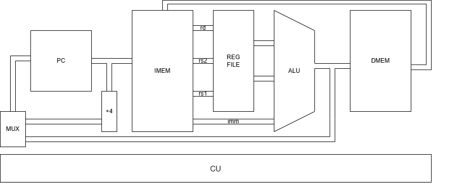

# Why I'm building a RISC-V core from scratch

I'm Alex, 18, living in Germany. I've been into programming and math for a long time, and I want to understand computers all the way down, including the hardware itself. So I'm building a CPU in SystemVerilog and writing about it as I go.

## What is RV32I?
RISC-V is an open instruction set. RV32I is its smallest 32-bit integer part: about 40 instructions (add, load, store, branch, jump). It's simple enough to build alone, and real enough to run actual programs.

## First design

In the first version everything happens in one clock cycle: fetch, decode, execute, memory, write back.

## Plan
1. Single-cycle RV32I
2. 5-stage pipeline
3. M extension
4. Branch predictor
5. Caches

Tools: SystemVerilog, Verilator, GTKWave, riscv-tests, later an FPGA.

I'll write a post after each stage, including what broke.

Code: [rv32im-core](https://github.com/OlSo-ASM/rv32im-core)
